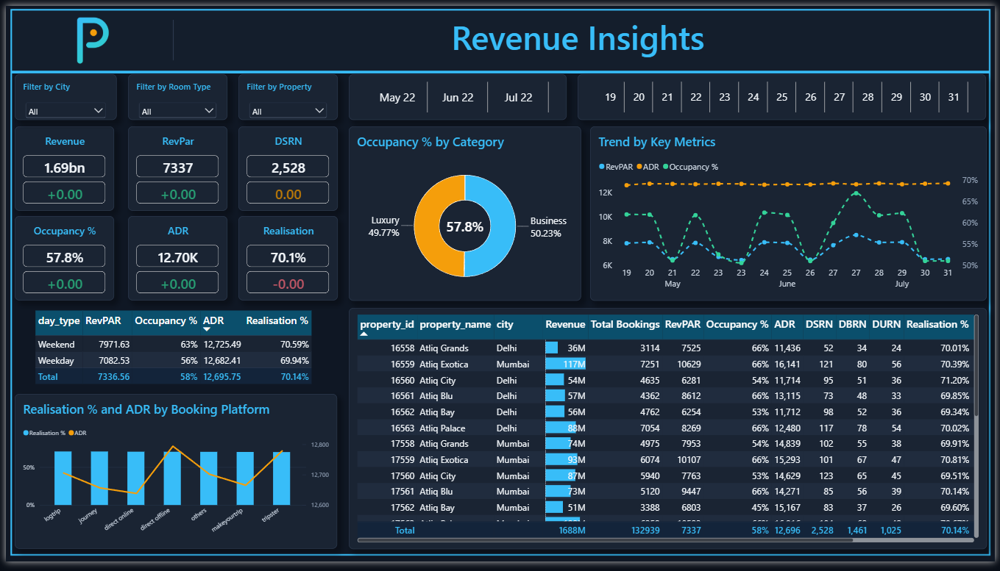

# Hospitality Revenue Analysis: AtliQ Grands

A Power BI revenue dashboard for a hotel chain with 25 hotels across 4 Indian cities, with every KPI independently checked in Python.



**[View the presentation (PDF)](presentation/hospitality_analysis_presentation.pdf)**

## Business Problem

AtliQ Grands runs luxury and business hotels in Mumbai, Delhi, Bangalore and Hyderabad. The company has been losing market share and revenue to competitors. Its revenue team needs a dashboard that shows how each hotel, city and room type is performing, and where revenue is being lost.

## Tools

- **Power BI** for the data model, DAX measures and dashboard
- **Power Query** for data preparation
- **Python (pandas)** to independently check every KPI and explore the findings

## Dataset

- **Period:** the raw data covers 1 May to 31 July 2022. The analysis uses **1 May to 30 July** (91 days, 13 full weeks). See Data preparation.
- **Size:** 134,590 bookings in the raw data, 132,939 in the analysis, across 25 hotels
- **Source:** [Codebasics Resume Project Challenge](https://codebasics.io/challenge/codebasics-resume-project-challenge), "Provide Insights to the Revenue Team in the Hospitality Domain"
- **Note:** AtliQ Grands is a fictional company and the data is created for learning purposes. All amounts are in Indian rupees (₹).

| File | Contents |
|---|---|
| `fact_bookings.csv` | One row per booking: dates, guests, room type, platform, rating, status and revenue |
| `fact_aggregated_bookings.csv` | Rooms booked and room capacity per hotel, room type and day |
| `dim_date.csv` | Calendar for the 92 days |
| `dim_hotels.csv` | Hotel name, category (Luxury or Business) and city |
| `dim_rooms.csv` | Room types: Standard, Elite, Premium and Presidential |
| `metrics-list.xlsx` | Metric definitions provided with the challenge |

## Project Structure

```
hospitality-data-analysis/
├── data/
│   └── raw/                  Original CSV files and metrics list
├── notebooks/
│   └── 01_kpi_validation.ipynb
├── docs/
│   ├── data_model.md         Tables, relationships and data preparation
│   └── dax_measures.md       Every DAX measure, with fixes explained
├── dashboard/
│   ├── hospitality-data-analysis.pbix
│   └── screenshots/
└── presentation/
    └── hospitality_analysis_presentation.pdf
```

## Data Model

A star schema with two fact tables (`fact_bookings` and `fact_aggregated_bookings`) linked to three shared dimension tables (`dim_date`, `dim_hotels` and `dim_rooms`). Full details are in [`docs/data_model.md`](docs/data_model.md).

### Data preparation

- **Rebuilt the weekend flag.** The raw `day_type` column treats Saturday and Sunday as the weekend. In hotels, the busy weekend nights are Friday and Saturday, so a new calculated column was created:
  ```dax
  day_type =
  VAR wkd = WEEKDAY(dim_date[date])
  RETURN IF(wkd > 5, "Weekend", "Weekday")
  ```
- **Rebuilt the week number.** The raw `week no` column stored text like `W 19` in every row. It was replaced with a numeric column, `wn = WEEKNUM(dim_date[date])`, so weeks can be sorted and compared.
- **Excluded week 32.** The data ends on Sunday 31 July, the only day in week 32. A report-level filter removes it, leaving 13 complete weeks.

## Dashboard

A single page with:
- **Six KPI cards:** Revenue, RevPAR, DSRN, Occupancy %, ADR and Realisation %, each with its change from the previous week
- **Slicers** for city, room type, hotel, month and week
- **Occupancy by hotel category** and a **weekly trend** of Occupancy, ADR and RevPAR
- **Weekday vs. weekend** comparison
- **Realisation % and ADR by booking platform**
- **A hotel table** with all key metrics for each property
- **Six tooltip pages:** hovering over a KPI card shows that metric by week, split by weekday and weekend

All 25 measures are documented in [`docs/dax_measures.md`](docs/dax_measures.md).

## Validation

Every dashboard KPI was recalculated independently in Python in [`notebooks/01_kpi_validation.ipynb`](notebooks/01_kpi_validation.ipynb). The checks found and fixed two problems in the week-over-week measures:

1. **The Occupancy card showed the revenue change.** The `Occupancy WoW change %` measure used `[Revenue]` instead of `[Occupancy %]`.
2. **The default view compared a one-day week with a full week.** The data ends on Sunday 31 July, which is the only day in week 32. With no week selected, the cards compared that single day against all of week 31, so revenue appeared to fall by 81.7%. Week 32 is now excluded with a report-level filter, so the cards compare the last two complete weeks and show the real change of +0.2%.

## Key Numbers

| Metric | Value |
|---|---|
| Revenue | ₹1,687.8 million |
| Total bookings | 132,939 |
| Occupancy | 57.8% |
| Average daily rate (ADR) | ₹12,696 |
| Revenue per available room (RevPAR) | ₹7,337 |
| Realisation | 70.1% |
| Cancellation rate | 24.8% |
| Average rating | 3.62 out of 5 |

## Findings

### 1. Better-rated hotels are much fuller

The 25 hotels fall into three clear groups by guest rating, and occupancy rises with each step up.

| Rating group | Hotels | Average rating | Occupancy | ADR |
|---|---|---|---|---|
| High | 12 | 4.25 to 4.32 | 65.9% | ₹12,811 |
| Mid | 9 | 3.01 to 3.08 | 53.4% | ₹12,423 |
| Low | 4 | 2.30 to 2.37 | 44.6% | ₹12,941 |

Low-rated hotels charge about the same as high-rated ones, so price is not what keeps them empty. Guest experience is the biggest difference between hotels that fill up and hotels that don't.

### 2. Atliq Seasons in Mumbai is the most expensive and the lowest rated

Atliq Seasons charges the highest average rate of all 25 hotels (₹16,597) but has the lowest rating (2.30) and one of the lowest occupancy rates (44.6%). Guests are paying the most and enjoying it the least.

### 3. One in four bookings is cancelled

| Booking status | Share |
|---|---|
| Checked out | 70.1% |
| Cancelled | 24.8% |
| No show | 5.0% |

Cancelled bookings only pay a 40% fee, so cancellations cost **₹295.2 million**, or 14.9% of all booked revenue. The cancellation rate is about 25% in every city, room type and booking platform, so this is a company-wide issue, not a problem with any single hotel or channel.

### 4. Mumbai brings in the most money, Hyderabad the least per room

| City | Revenue | Share | ADR | RevPAR |
|---|---|---|---|---|
| Mumbai | ₹660.6M | 39% | ₹15,385 | ₹8,897 |
| Bangalore | ₹415.0M | 25% | ₹13,127 | ₹7,309 |
| Hyderabad | ₹321.2M | 19% | ₹9,322 | ₹5,405 |
| Delhi | ₹290.9M | 17% | ₹12,159 | ₹7,349 |

Hyderabad has the second highest number of bookings but the lowest prices, so it earns the least from each available room. Delhi has the fewest hotels but the highest occupancy (60.4%).

### 5. Weekends are busier, but prices stay the same

| Day type | Occupancy | ADR | RevPAR |
|---|---|---|---|
| Weekday (Sunday to Thursday) | 55.8% | ₹12,682 | ₹7,083 |
| Weekend (Friday and Saturday) | 62.6% | ₹12,725 | ₹7,972 |

Hotels are noticeably fuller on Friday and Saturday nights, but the average rate is almost identical. Prices do not change with demand.

### 6. Presidential rooms earn the most per room

| Room class | Share of bookings | ADR | RevPAR |
|---|---|---|---|
| Elite | 36.8% | ₹11,320 | ₹6,515 |
| Standard | 28.6% | ₹8,052 | ₹4,652 |
| Premium | 22.7% | ₹15,118 | ₹8,691 |
| Presidential | 11.9% | ₹23,433 | ₹13,858 |

Presidential rooms are the least booked but earn almost three times more per available room than Standard rooms. They also have the highest occupancy of any room class (59.1%).

### 7. Most bookings come through third-party platforms

| Platform | Share of bookings |
|---|---|
| Others | 40.9% |
| MakeYourTrip | 20.0% |
| LogTrip | 11.0% |
| Direct online | 9.9% |
| Tripster | 7.1% |
| Journey | 6.0% |
| Direct offline | 5.0% |

Only 15% of bookings come directly to the hotels. Realisation (about 70%) and ADR (about ₹12,700) are almost the same on every platform, so no platform brings better or more reliable guests.

### 8. Performance is flat across the three months

Revenue was ₹581.9M in May, ₹553.9M in June and ₹551.9M in July (30 days, since 31 July is excluded). Occupancy stayed between 57.2% and 58.5%. There is no growth over the period.

### 9. Many guests don't leave a rating

Only 60% of guests who checked out left a rating. Since ratings are so closely linked to occupancy, the missing 40% is a gap in the feedback the hotels rely on.

### A note on the data

- **Occupancy counts cancelled bookings as occupied rooms.** The `successful_bookings` column includes cancellations. This follows the challenge's metric definitions, but real occupancy was lower.
- **ADR is calculated per booking**, including cancelled bookings, as defined in the challenge's metrics list. In the hotel industry ADR is usually revenue per room night sold.
- **Two hotels share the same name.** Two different properties are called Atliq Exotica in Mumbai, so hotels are identified by `property_id`.
- **31 July is excluded** so the analysis covers 13 complete weeks. The raw CSV files still contain it.
- The data is synthetic, which explains very regular patterns such as weekly occupancy switching between about 62% and 51%.

## Recommendations

1. **Improve the four low-rated hotels first.** Ratings are the clearest link to occupancy in the data. Review guest feedback at Atliq Seasons (Mumbai), Atliq Exotica (Hyderabad), Atliq Grands (Bangalore) and Atliq Bay (Mumbai). If they reached the same occupancy as the high-rated hotels, they would fill over 8,000 more room nights in three months.
2. **Review pricing at Atliq Seasons.** It charges the most and is rated the lowest. Either improve the experience to match the price, or lower the price until the experience improves.
3. **Reduce cancellations.** Offer a lower non-refundable rate, ask for a deposit on flexible bookings, and send reminders before check-in. Bringing the cancellation rate down from 25% to 20% would keep about ₹58 million in revenue over three months.
4. **Charge more on Friday and Saturday nights.** Weekend demand is higher but prices are not. A small weekend increase, paired with weekday offers for business travellers, would balance demand and raise revenue.
5. **Grow direct bookings.** Only 15% of bookings are direct. Offer perks for booking direct, such as free breakfast or late checkout, to reduce commissions paid to third-party platforms.
6. **Review prices in Hyderabad.** Rates there are much lower than in other cities, even at hotels with high ratings. Compare with local competitors to see if prices can go up.
7. **Promote Presidential and Premium rooms.** They earn far more per room. Offer upgrades at check-in and highlight these rooms in marketing.
8. **Collect more ratings.** Ask every guest for a rating at checkout. More feedback makes it easier to spot problems early.

## How to Run

**Dashboard**
1. Open `dashboard/hospitality-data-analysis.pbix` in Power BI Desktop.
2. The file loads data from the original author's computer. To refresh it, go to **Transform data**, then **Data source settings**, choose **Change Source** and point each source to your copy of the `data/raw` folder.

**Validation notebook**
1. Install the dependencies:
   ```
   pip install -r requirements.txt
   ```
2. Run `notebooks/01_kpi_validation.ipynb` from the `notebooks` folder.

## Acknowledgements

The dataset, business problem and metric definitions come from the [Codebasics Resume Project Challenge](https://codebasics.io/challenge/codebasics-resume-project-challenge). The data model fixes, KPI validation, findings and recommendations in this repository are my own.

## Author

**Aaron George Saju**
[GitHub](https://github.com/aarongeorge96)
